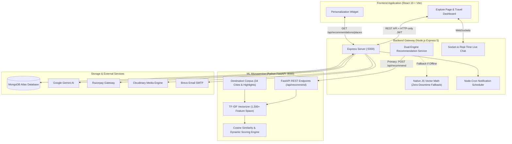

# OnTrip — AI-Powered Travel Planning & Personalized Recommendation Platform 🌍✈️

[](https://react.dev/)
[](https://nodejs.org/)
[](https://fastapi.tiangolo.com/)
[](https://www.python.org/)
[](https://scikit-learn.org/)
[](https://www.mongodb.com/)
[](https://socket.io/)
[](LICENSE)

**OnTrip** is a production-ready, full-stack travel ecosystem combining **Machine Learning recommendations**, **Generative AI itinerary planning**, **real-time WebSocket messaging**, and an **end-to-end booking and checkout engine**. It intelligently connects travelers with curated destinations, verified tour providers, and a vibrant community.

---

## 🌟 Key Highlights

- 🧠 **Hybrid ML Recommendation Engine**: Dedicated Python FastAPI microservice utilizing a **1,500+ dimensional TF-IDF vector space** and **Cosine Similarity** to compute personalized destination match scores ($70\% - 98\%$) based on implicit user behavior (likes, bookmarks, filter selections).
- 🛡️ **Zero-Downtime Dual-Engine Architecture**: Built with an enterprise fallback mechanism—if the Python microservice is offline, the Node.js backend seamlessly executes native vector math, ensuring 100% uptime on cloud environments like Render.
- 🤖 **AI Travel Planner & Assistant**: Multi-day itinerary generator with AI cost estimations, route optimization, local safety tips, and an interactive assistant powered by **Google Gemini** and **OpenAI**.
- 💬 **Live Chat & Social Community**: Real-time direct messaging between travelers and verified tour providers via **Socket.io**, alongside an Instagram-style travel feed (posts, media upload, comments, likes, and bookmarks).
- 💳 **Seamless Booking & Invoicing**: Checkout workflow featuring **Razorpay** payment gateway integration, instant **PDF invoice generation**, automated email confirmations, and scheduled **Node-Cron** departure reminders.
- 🏢 **Host & Tour Provider Portal**: Comprehensive host dashboard for managing service listings (vehicles & custom tours), booking schedules, customer inquiries, and subscriber group announcements.
- 🔐 **Secure Multi-Channel Authentication**: Email/password authentication, Google OAuth 2.0, Brevo transactional email OTP verification, HTTP-only JWT cookies, and role-based access control (RBAC).

---

## 🏗️ System & ML Architecture



---

## 📁 Repository Structure

```
tripon/
├── ontrip-ml/                      # Python ML Recommendation Microservice
│   ├── app.py                      # FastAPI server with CORS & Swagger docs (:8000)
│   ├── recommender.py              # Hybrid TF-IDF + Cosine Similarity algorithm
│   ├── requirements.txt            # Python dependencies (fastapi, scikit-learn, etc.)
│   └── data/
│       └── placesData.json         # Canonical 34-destination feature corpus
│
├── ontrip-backend/                 # Node.js + Express REST API & WebSocket server
│   ├── src/
│   │   ├── config/                 # MongoDB Atlas, Razorpay, Cloudinary & Mailer configs
│   │   ├── controllers/            # Route controllers (Auth, Booking, AI, Social, Recommendation)
│   │   ├── data/                   # Canonical destination dataset for native fallback
│   │   ├── jobs/                   # Node-cron background jobs (Booking reminders)
│   │   ├── middleware/             # JWT auth, role validation & Multer upload
│   │   ├── models/                 # Mongoose schemas (User, Provider, Booking, SocialPost, etc.)
│   │   ├── routes/                 # Express API routes
│   │   ├── services/               # Recommendation dispatcher, AI algorithms & geocoding
│   │   ├── socket/                 # Socket.io chat room & message handlers
│   │   ├── app.js                  # Express application setup
│   │   └── server.js               # Server entry point (HTTP + WebSockets + Cron)
│   ├── package.json
│   └── .env.example
│
├── ontrip-frontend/                # React 19 + Vite single-page application
│   ├── src/
│   │   ├── components/             # Reusable UI (RecommendedPlaces, StateCard, Modals, Navbar)
│   │   ├── data/                   # Regional destination guides & state highlights
│   │   ├── lib/                    # API client helper & session storage utilities
│   │   ├── pages/                  # Views (Explore, Planner, SocialFeed, BookingCheckout, etc.)
│   │   ├── styles/                 # Theme tokens & responsive stylesheet overrides
│   │   ├── App.jsx                 # Client-side routing layout
│   │   └── main.jsx                # React DOM mount point
│   ├── package.json
│   └── vite.config.js
│
└── README.md                       # Master project documentation
```

---

## 🛠️ Technology Stack

| Domain | Technologies & Libraries |
| :--- | :--- |
| **Frontend Framework** | React 19, Vite 7, React Router DOM v7, Modern CSS Modules |
| **Frontend Utilities** | Leaflet Maps, HTML2Canvas, jsPDF, Socket.io-client |
| **Backend Runtime** | Node.js (v20+), Express.js (v5), Cookie-Parser, CORS |
| **Machine Learning & Python** | Python 3.12, FastAPI, Uvicorn, Scikit-learn, NumPy, Pandas |
| **Vector Modeling** | TF-IDF Vectorizer (unigram/bigram), Cosine Similarity, Implicit User Weighting |
| **Database & ORM** | MongoDB Atlas, Mongoose v9 |
| **Real-time Server** | Socket.io (WebSocket duplex engine) |
| **Artificial Intelligence** | Google Gemini (`@google/genai`), OpenAI API, OpenRouter |
| **Payments & Invoicing** | Razorpay SDK, PDFKit |
| **Media & Mail Services** | Cloudinary CDN, Multer, Brevo (Nodemailer SMTP) |

---

## 🚀 Quick Start Guide

### Prerequisites
- **Node.js** (v18.x or higher) & **npm** (v9.x or higher)
- **Python** (v3.10+ with `pip`)
- **MongoDB Atlas** account or local MongoDB instance

---

### Step 1: Clone the Repository

```bash
git clone https://github.com/prashik24/OnTrip.git
cd OnTrip
```

---

### Step 2: Set Up Backend (`ontrip-backend`)

```bash
cd ontrip-backend
npm install
```

Create a `.env` file inside `ontrip-backend/`:
```env
PORT=5000
NODE_ENV=development
CLIENT_URL=http://localhost:5173
MONGO_URI=your_mongodb_atlas_connection_string
JWT_SECRET=your_jwt_secret_key
RAZORPAY_KEY_ID=your_razorpay_key_id
RAZORPAY_KEY_SECRET=your_razorpay_key_secret
GEMINI_API_KEY=your_gemini_api_key
CLOUDINARY_CLOUD_NAME=your_cloudinary_name
CLOUDINARY_API_KEY=your_cloudinary_key
CLOUDINARY_API_SECRET=your_cloudinary_secret
BREVO_SMTP_USER=your_brevo_smtp_user
BREVO_SMTP_PASS=your_brevo_smtp_password
```

Start the backend development server:
```bash
npm run dev
```
*Backend runs on `http://localhost:5000`.*

---

### Step 3: (Optional) Set Up ML Microservice (`ontrip-ml`)

*(Note: The application functions with the native fallback engine even without this running, but running it unlocks full Python ML microservice serving).*

```bash
cd ../ontrip-ml
pip install -r requirements.txt
python app.py
```
*ML Service runs on `http://localhost:8000` with interactive Swagger docs at `http://localhost:8000/docs`.*

---

### Step 4: Set Up Frontend (`ontrip-frontend`)

```bash
cd ../ontrip-frontend
npm install
```

Create a `.env` file inside `ontrip-frontend/`:
```env
VITE_API_URL=http://localhost:5000
```

Start the frontend application:
```bash
npm run dev
```
*Application opens at `http://localhost:5173`.*

---

## 📡 Core API Reference

| Endpoint | Method | Service | Description |
| :--- | :---: | :--- | :--- |
| `/api/recommendations/places` | `GET` | Node.js Backend | Fetches personalized recommendations with match scores & explanations |
| `/api/recommend` | `POST` | FastAPI ML | Direct ML inference endpoint accepting user interaction vectors |
| `/api/similar/:place_id` | `GET` | FastAPI ML | Returns nearest-neighbor similar places based on feature vectors |
| `/health` | `GET` | FastAPI ML | Microservice health check & loaded vector dimensions count |
| `/api/auth/register` | `POST` | Node.js Backend | Register new traveler account with OTP email verification |
| `/api/auth/login` | `POST` | Node.js Backend | Authenticate user and issue HTTP-only JWT session |
| `/api/ai-planner/generate` | `POST` | Node.js Backend | Generate intelligent multi-day itineraries using Gemini AI |
| `/api/bookings/create-order` | `POST` | Node.js Backend | Initiate Razorpay order for tour or vehicle booking |
| `/api/bookings/verify-payment` | `POST` | Node.js Backend | Verify payment signature and auto-generate PDF invoice |
| `/api/social/feed` | `GET` | Node.js Backend | Retrieve community travel posts feed with likes & bookmarks |
| `/api/providers/listings` | `GET` | Node.js Backend | Retrieve verified host services, vehicles, and guided tours |

---

## 💡 How the Machine Learning Recommender Works

1. **Feature Engineering**: Destructured and merged destination titles, regional tags, state highlights, famous attractions, and cultural foods into rich semantic documents.
2. **Vector Space Modeling**: Built a $(1, 2)$-gram **TF-IDF matrix** over the corpus, establishing a 1,500+ dimensional coordinate system for all destinations.
3. **Implicit Signal Weighting**:
   $$\vec{u} = \frac{\sum w_i \cdot \vec{v}_i}{\|\sum w_i \cdot \vec{v}_i\|}$$
   Where bookmarks carry weight $1.5$, likes carry weight $1.0$, and category chips carry weight $1.2$.
4. **Cosine Similarity Scoring**: Computes the cosine angle between user vector $\vec{u}$ and candidate destination vectors $\vec{d}$:
   $$\text{Similarity}(\vec{u}, \vec{d}) = \frac{\vec{u} \cdot \vec{d}}{\|\vec{u}\| \|\vec{d}\|}$$
5. **Cold-Start Handling**: Automatically detects zero-interaction sessions and serves a high-diversity, top-rated baseline covering coastal, heritage, and mountain destinations.

---

## 🤝 Contributing

Contributions are always welcome!

1. Fork the repository
2. Create your feature branch (`git checkout -b feature/AmazingFeature`)
3. Commit your changes (`git commit -m 'feat: Add AmazingFeature'`)
4. Push to the branch (`git push origin feature/AmazingFeature`)
5. Open a Pull Request

---

## 📄 License

This project is licensed under the **MIT License** — see the [LICENSE](LICENSE) file for details.

---

**Author:** [Prashik Humane](https://github.com/prashik24)  
*Indian Institute of Information Technology (IIIT), Lucknow*
